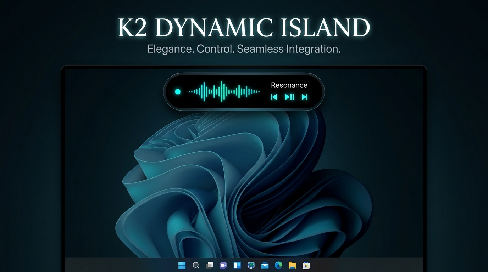

# 🏝️ K2 Dynamic Island for Windows

### The Next-Generation Fluid Desktop Capsule for Windows 10 & 11

[🌐 **Official Website**](https://k2dynamicisland.github.io/) • [📥 **Download Setup (.exe)**](https://k2dynamicisland.github.io/downloads/K2DynamicIsland-Setup.exe) • [📦 **GitHub Releases**](https://github.com/K2DynamicIsland/K2DynamicIsland.github.io/releases)

---

## ✨ Features

- 🎵 **Real-Time Audio Activity**: Integrated WASAPI soundwave tracker with a responsive mini-equalizer supporting YouTube, Spotify, VLC, and Windows system audio.
- 📜 **Smooth Marquee Scrolling**: Seamless, infinitely looping song title ticker for currently playing tracks.
- ⏸️ **Smart Pause Detection**: Automatically halts equalizer animation and cleans the capsule UI when music is paused.
- 📂 **Drag & Drop Station**: Drop any file or directory directly onto the capsule to inspect Unicode paths, copy paths to clipboard, or reveal in Windows Explorer.
- 🎨 **Dynamic Themes & Wallpaper Motion**: Customize with animated GIF backdrops (Spider-Verse, Cat, Stitch), Aurora Lively canvas, or frosted acrylic glass blur.
- ⚡ **Native C++17 Performance**: Stripped and hardened binary under 488 KB, ultra-low resource usage (< 50 MB RAM), and zero telemetry.

---

## 📥 Installation

1. Download the latest installer from [GitHub Releases](https://github.com/K2DynamicIsland/K2DynamicIsland.github.io/releases/latest) or directly:
   👉 **[Download K2DynamicIsland-Setup.exe](https://k2dynamicisland.github.io/downloads/K2DynamicIsland-Setup.exe)**
2. Run `K2DynamicIsland-Setup.exe` and follow the quick setup wizard.
3. Enjoy your new fluid desktop capsule!

---

## ⭐ Support & Stars

If you enjoy using **K2 Dynamic Island**, please consider giving this repository a **Star (⭐)** to support ongoing development!

---

Created with ❤️ by <a href="https://kimsokun.github.io/">Kim Sokun</a>.

